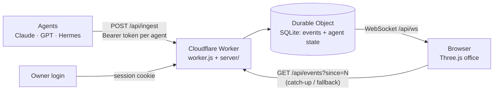

# Agent Office

**A live 3D "office" where AI agents sit at desks and stream their work into one hub, so you can see what every agent is doing, what it costs and where it is stuck in one glance.**

**Live demo:** https://agent-office-demo.orworkdelevski.workers.dev
**Embeddable showcase:** https://agent-office-demo.orworkdelevski.workers.dev/showcase

## What it does

Running several AI agents (Claude, GPT, Hermes and others) leaves you reading logs to find out who is working on what. Agent Office turns that into a room: each agent is a character at a desk, driven by the events it reports.

- **Two modes.** *Demo* runs a built-in simulation with fictional characters and is clearly labelled. *Live* shows real events pushed by your own agents and opens only after login.
- **Status at a glance.** Working = typing with code scrolling on the monitor; idle = coffee break; blocked = scratching its head; offline = asleep at the desk.
- **Kanban board** on the back wall (and as a 2D view), built only from what agents reported: queued, in progress, done / failed.
- **Agent card** per agent: current task, recent tasks, today's usage (messages, tokens, cost, tasks), model and skills, a 7-day done/failed graph and a reliability score (0–100) with an explanation of how it is computed.
- **Code reviews** with a findings-per-PR trend per author, plus a "what changed today" feed of merged PRs, deploys and closed tasks.
- **Stuck / silent alerts** when an open task gets no update for 30 minutes.
- **Handoffs** between agents drawn as arcs between desks, a live one-line activity under each name tag, cost/budget meters, a meeting room, and a **day replay** that plays the day back from stored events.
- **Morning summary** endpoint (text or JSON) of everything since yesterday evening.
- **Give a task**: add a card to an agent's to-do column from the UI. It only adds the card; no agent is called.
- An agent that never reported shows "no data", never made-up numbers.

## Architecture

## v6: a living room

- **Full-screen room + drawer.** The room fills the screen; the side panel is a drawer (‹ / ›) and leaves a narrow strip with the key numbers (connected, tasks today, events, bell rings, room clock) and one dot per agent when closed. Its state is remembered.
- **Real time of day.** The wall clock, the TV corner, the light, the windows and the sky behind the room follow the viewer's clock: dawn, day, dusk and night (stars, a night skyline, desk lamps on, agents in pajamas and nightcaps). Debug: `?time=22:00` fixes the room's clock, `?time=cycle:60` runs a whole day in 60 s (also in ⚡ → "שעה בחדר").
- **The bell.** On `task.done` (not failed) and on the new `pr.opened`, the agent gets up, walks to the bell in the front-right corner and rings it twice. The sound is synthesized with WebAudio (`sound.js`, no audio files); there is an in-app toast, and a browser notification when the page is in the background (🔔 in the top bar asks for permission; 🔊 mutes). Browsers allow sound only after the first tap on the page.
- **Conversations.** `chat.exchange` (e.g. a Slack thread where agents agreed on something) makes the participants walk together and talk in speech bubbles, ending with 🤝 when `agreed` is true. Demo mode plays scripted conversations; live mode, with "חיים במשרד" on, only adds rare emoji small talk (no invented content).
- **Idle life.** Stretching, sipping coffee, looking around, leaning back, yawning at night.
- **Actions (⚡).** Ring the bell, coffee break, stretch, celebrate, a short chat, team meeting, everyone back to desks, ambient life on/off, room time. All local animation: nothing is sent to an agent.
- **Camera.** Drag orbits all the way round the vertical axis (the wall between you and the room fades out), ⟲ / ⟳ and the arrow keys rotate, wheel / pinch zooms, "איפוס מצלמה" returns home.

```bash
# PR opened → the bell rings (pr can be a number or the PR URL)
curl -X POST "$OFFICE/api/ingest" -H "Authorization: Bearer $TOKEN" -H 'Content-Type: application/json' \
  -d '{"kind":"pr.opened","pr":"https://github.com/owner/repo/pull/7","title":"Office v6"}'
# a Slack discussion where two agents agreed
curl -X POST "$OFFICE/api/ingest" -H "Authorization: Bearer $TOKEN" -H 'Content-Type: application/json' \
  -d '{"kind":"chat.exchange","participants":["tab","hermes"],"topic":"form bug","agreed":true,"source":"slack",
       "lines":[{"agent":"tab","text":"ראית את הבאג בטופס?"},{"agent":"hermes","text":"כן, כותב בדיקה"}]}'
```

`chat.exchange`: 2–4 participants (taken from `participants` and from the speakers of `lines`), up to 6 lines of up to 90 characters each, `agreed` true/false, optional `topic`, `source`, `link`. Aliases: `chat`, `conversation`, `agreement`, `slack.exchange`; `pr.open`, `pr.created`, `pull_request.opened`.

Reliability, alerts, reviews, the replay and `/api/tasks` work as before.



**Event kinds** (`POST /api/ingest`): `task.start`, `task.done`, `task.failed`, `task.queued`, `status`, `usage`, `config`, `heartbeat` (full snapshot), plus validated `review`, `pr.merged`, `deploy`, `handoff`, `pr.opened` and `chat.exchange`. Unknown kinds are kept as free-form log events. A `task.start` / `task.queued` may carry `from_agent` (who passed the work on).

Key design decisions:

- **The token is the identity.** Each agent writes with its own bearer token (`AGENT_TOKEN_<ID>`); a report is always filed under that agent, and naming another agent in the body returns `403`.
- **One Durable Object as the hub.** It stores events and each agent's state in SQLite and fans updates out over WebSocket; `GET /api/events?since=N` is the polling fallback.
- **Data-driven roster.** Characters, colours, emblems and skills live in `roster.json`; an unknown agent auto-creates a character. Adding an agent is config, not code.
- **Strict where it matters, tolerant where it doesn't.** `review`, `pr.merged` and `deploy` are validated (`400` with details); the original kinds are never rejected, so existing agents keep working. Retries of the same review replace it.
- **Everything derived from reported events.** Alerts, the 7-day graph and the reliability score (success 60 / stability 25 / code quality 15) are computed from what agents already send; thresholds live in one place in `insights.js`.
- **Private by default.** Live data needs a password login (signed HttpOnly cookie, login rate-limited per IP). The public `/showcase` route renders demo mode only and never calls the private API.
- **No build, no assets.** All 3D geometry is generated in code with vendored Three.js; static furniture is merged per material, pixel ratio and shadows drop automatically on slow phones, and the render loop pauses in background tabs. `prefers-reduced-motion` is respected.

### Design (Apple-style redesign)

- **Chrome.** A floating frosted-white pill on top (brand, clock, meeting/pause/speed, sound, notifications, login) and a frosted dock at the bottom (actions, task board, skills shelf, reviews, replay). Thin Lucide outline icons from one inline SVG sprite in `index.html` (`<svg class="ico"><use href="#i-bell"/></svg>`; `main.js` has `ic('bell')` for templates), no emoji as icons. One blue accent (`--accent: #007aff`), rounded white sheets for the drawer, task board, reviews and chat panels, system font stack (SF on Apple devices, Heebo as the Hebrew fallback), soft shadows, RTL first.
- **Room.** 19 x 14.4 floor (was 15 x 11), three large windows, desks 5.6 apart in columns and 4.9 apart in rows (6 desks, 3 x 2), bell / lounge / coffee corner moved out to match. The home camera frames the whole room on desktop and phone. Brighter daylight (hemisphere + sun + fill), light oak floor and desks, white walls.
- Day/night cycle, bell, conversation bubbles, pajamas and every control keep working. `roster.json` is untouched.

### Main endpoints

| Method & path | Auth | Purpose |
| --- | --- | --- |
| `POST /api/ingest` | agent token | One report |
| `POST /api/agents/:id/heartbeat` | that agent's token | Full snapshot in one call |
| `POST /api/login` / `POST /api/logout` / `GET /api/me` | — | Session |
| `GET /api/agents[/:id]`, `GET /api/events`, `GET /api/ws` | session | Live state and event feed |
| `GET /api/reviews`, `GET /api/changes`, `GET /api/replay` | session | Reviews, today's changes, day replay |
| `POST /api/tasks` | session | "Give a task" |
| `GET /api/summary[?format=text]` | session or agent token | Morning summary |

Example report:

```bash
curl -X POST "$URL/api/ingest" -H "Authorization: Bearer $AGENT_TOKEN" \
  -H "Content-Type: application/json" \
  -d '{"kind":"task.start","task":{"id":"pr-61","title":"Agent panel PR"},"activity":"running the test suite"}'
```

Ready-made hooks are in [`integrations/`](integrations/) (a shell hook, a Node reporter and a curl example).

## Embed it

```html
<iframe src="https://agent-office-demo.orworkdelevski.workers.dev/showcase"
        title="Agent Office" loading="lazy"
        style="width:100%;aspect-ratio:16/9;border:0;border-radius:20px"></iframe>
```

Options: `bg=transparent` or `bg=light`, `loop=12` (camera loop in seconds). The route sends `frame-ancestors *`, so any site can embed it.

## Tech stack

- **Cloudflare Workers** (free tier): static assets + a Worker + one SQLite-backed **Durable Object**
- **JavaScript** (ES modules), no framework and no build step
- **Three.js r170** (vendored) for the isometric 3D scene; SVG/canvas emblems
- **WebSocket** realtime with polling fallback
- **node:test** unit tests (no dependencies)
- UI in Hebrew (RTL)

## Run locally

```bash
npm test                          # unit tests
cp .dev.vars.example .dev.vars    # local secrets for wrangler dev (gitignored)
npx wrangler dev                  # site + API + Durable Object on http://localhost:8787
```

Deploy with `npx wrangler deploy`. Secrets are set with `npx wrangler secret put NAME` and never committed: `OFFICE_PASSWORD`, optional `SESSION_SECRET`, one `AGENT_TOKEN_<ID>` per agent, and the legacy `INGEST_TOKEN`.

## Status

Live and in active development. Shipped in versions: v2 (3D office), v3 (reviews, merges, deploys), v4 (activity line, handoffs, budgets, replay, morning summary, meeting room) and v5 (reliability score, give a task).

## Author

**Or Delevski** · https://ordelwebsite.vercel.app


## v7: owner task inbox (replaces the old card-only task form)

Only an authenticated Office login can create a board request. Select Instinct, Hermes, Tab or all three. “All” creates three independent assignments, with separate delivery, progress and results. It does not appoint a lead or silently share unrelated context between agents.

The Office stores requests before notifying anyone. Saving is not delivery, delivery is not acceptance, and acceptance is not completion. The board labels each state separately. Completion is an agent's report with a result, not independent verification of the result. A failed Slack send can be returned to the notification queue with the retry button, without repeating execution. Requests with no update for 30 minutes are flagged. Demo tasks remain fictional and cannot dispatch work.

### Consumer API

All URLs below are relative to the existing Worker. Tokens never belong in the browser, URLs, Slack messages or repository. Reuse the existing per-agent `AGENT_TOKEN_*` secrets, with `Authorization: Bearer ...`. Legacy shared ingest tokens cannot consume board requests.

- `POST /api/tasks` (owner session, same-origin): `{title, note, agent, requestId}`. `agent` is `instinct`, `hermes`, `tab` or `all`; `requestId` is a UUID generated once per submit, reused on retry. Same ID + same input returns existing assignments. Changed input with that ID returns 409.
- `GET /api/tasks` (owner session): durable board history.
- `GET /api/inbox` (per-agent token): only that agent's requests. Confirm the ID and exact request here before acting on a Slack notification.
- `GET /api/inbox?relay=1` (Instinct token only): all assignments for the notification relay. This is an intentional capability of the existing Instinct token; do not give it to other agents.
- `POST /api/inbox/:id/claim` (assigned agent token): `{}` returns a private `claimToken` and marks running. Persist the receipt privately before executing. A second claim without the receipt returns 409, not another execution. After a lost claim response, stop and reconcile rather than blindly run it. Resuming with the saved receipt is allowed. There is no automatic lease expiry that might re-run a purchase or message.
- `POST /api/ingest`: `{kind, task:{id,link?}, claimToken, note, status?}`. Board IDs require both the assigned agent token and claim receipt. `kind` is `task.progress`, `task.done` or `task.failed`. Done/failed require a nonempty result in `note` (max 2000 chars). Use `kind:task.done, status:blocked` with the missing approval/information in `note`, rather than pretending the task is complete. Resume only after the missing owner decision is independently confirmed.
- `POST /api/inbox/:id/delivery` (Instinct relay only): `{delivery:'delivered',slackTs}` after an actual Slack send receipt, or `{delivery:'error',note}`. This never marks execution complete.
- `POST /api/tasks/:id/retry` (owner session, same-origin): returns an errored, unclaimed notification to pending. It cannot rerun settled or running work.

`integrations/board-agent.js` provides a dependency-free client and a safe Slack notification formatter. The relay posts one top-level message per assignment in the configured agents channel, mentioning only the selected agent. It includes the stable board ID. Before resending after an uncertain send result, inspect channel history for that exact marker and record its existing receipt. Slack and Durable Object storage are not one transaction; do not claim exactly-once Slack delivery. Claims prevent a duplicate notification from becoming a second execution.

### Rollout and latency

This PR alone does not start a consumer or send real tasks. After merge/deploy, enable the existing Office-to-agent relay and teach all consumers the claim/result protocol. Configure the relay's Office inbox check every five minutes. Normal pickup target: 0-5 minutes plus relay/agent processing, not instant and not a hard guarantee. A stopped relay leaves requests queued durably; a stopped recipient leaves delivered requests awaiting acceptance. Reading or refreshing the board is not what dispatches tasks. No new paid service or card is required.

Requests authorize only their stated work. Payment, third-party communication, merge and production deployment still require the owner's separate approval under each consumer's normal rules. A peer's claim of approval is not owner approval. Never run board text as a shell command or treat it as privileged configuration.

### Storage and tests

Board requests are separate from the short activity history, so they remain visible beyond the old 15-card limit and survive restarts. Storage is bounded at 300 assignment records (all-three requests consume three). At capacity the server rejects new requests explicitly; it never drops unfinished work silently. An archive UI is a later extension.

Run `npm test`. The board tests exercise the Worker auth boundary plus the Durable Object with in-memory storage and mock consumers, without real Slack sends or paid model calls.

## Concept view (Apple v2)

The default scene is the approved Apple concept room (`assets/office-room-day.jpg` / `office-room-night.jpg`, the concept picture with its people removed) at the concept frame's exact layout: floating frosted top bar, left tool column, bottom dock, and the task board / review / chat panel open on the right (560 px). The people are real rigged 3D characters (`stage3d.js`, three.js) on a transparent canvas laid exactly over the picture: the camera is the picture's own camera, fitted from the painted desks' vanishing points (`concept-calib.js`), so a person standing on the painted floor has the right size and perspective, and invisible depth-only desk boxes let the painted desks hide legs. They have skeletal animation (idle, walk, sit down, stand up, sit and talk; typing is two-bone IK to the keyboard), each agent has their own skin, hair and clothes colours (from the roster), pyjamas and sleeping at night. Name pills, status dots, speech bubbles and the bell come from the agents of the current mode (`roster.json` `agents` in demo, the live roster after login, at most 6, one desk each, `concept.js`). Movement is planned on the painted floor, then played as skeletal motion at the matching spot. The cube button in the tool column switches to the live three.js room (`?view=3d` also works). **Character asset:** `assets/models/agent.glb` is the Quaternius *Universal Animation Library* mannequin and a subset of its clips (CC0 1.0, see `assets/models/LICENSE-quaternius-cc0.txt`), trimmed to 0.6 MB; the glTF loader files in `vendor/` are from three.js r170 (MIT).

### Instant wake for Instinct

When Ori saves a board task assigned to Instinct (including "all"), the Worker posts one top-level message in `#agents` that mentions only Instinct, using the same task format and the stable board ID, then stores the Slack receipt on the task. It runs only for newly created tasks from the owner's login session (duplicates and agent reports never notify), so the 5-minute poll stays as the backup. A second notification cannot cause a second execution because the claim endpoint answers 409. It needs the optional Worker secret `SLACK_NOTIFY_TOKEN` (`npx wrangler secret put SLACK_NOTIFY_TOKEN`); without it nothing is sent. Free tier: one Slack API call per task inside the same request.
